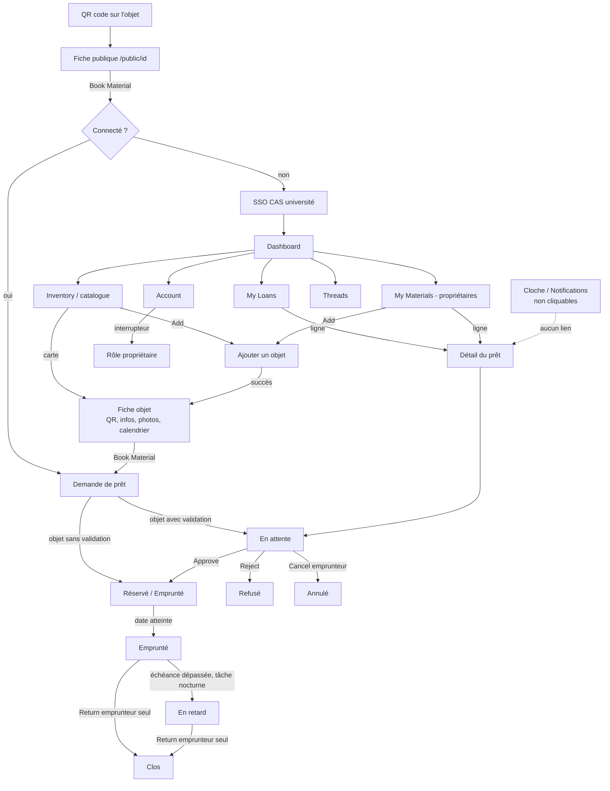

# Audit UX de la Matosthèque, pour concevoir InventAssos

Origine : Matosthèque (GitLab GRICAD, version téléchargée le 2026-11-05), lancée en local avec des données de test le 2026-11-09. Note de travail en français.

> Étude de l'expérience utilisateur seulement. La Matosthèque est sous licence propriétaire
> (usage de recherche uniquement) : on n'en reprend ni code, ni assets, ni textes. Les libellés cités
> ci-dessous le sont comme preuves de l'analyse, pas comme modèles à recopier.
> Captures (51) : non versionnées, l'interface étant sous licence propriétaire ; le mainteneur les a.

## 1. Synthèse

- **Verdict** : bonne intuition (un catalogue partagé, une fiche par objet avec QR code et calendrier, un circuit demande → validation → rendu), mais l'exécution est celle d'un tableau de bord de bureau générique. Elle est en anglais et peu fiable sur les états, avec plusieurs bugs qui cachent justement les informations critiques (prêt en retard invisible, disponibilité fausse).
- **À garder absolument** : (1) le QR code sur chaque objet, qui mène à une fiche publique ; (2) la fiche objet qui réunit photo, propriétaire, contact, statut et calendrier ; (3) la validation facultative, réglée objet par objet (« demander une validation » ou réservation directe).
- **À ne pas reproduire** : (1) des statuts calculés de façon peu fiable et mal affichés (« Available » sur un objet emprunté, retard absent de « Mes prêts ») ; (2) des actions qui ont des conséquences (refuser, annuler, rendre, supprimer définitivement) sans motif, sans confirmation ni retour clair, et un rendu déclaré par l'emprunteur seul ; (3) trop de données personnelles montrées au-delà de ce qui est utile.

## 2. Comment l'audit a été fait

**L'application a réellement tourné**, en local et sur une copie isolée (`ux/matos-run/`). Les fichiers d'origine n'ont pas été modifiés.

- Backend Django 5.0.3 / DRF 3.14 dans un venv dédié, avec **SQLite**. Les surcharges sont dans des fichiers ajoutés à la copie (`local_settings.py`, `local_urls.py`, `local_auth.py`) :
  - authentification centrale remplacée par une connexion de développement ;
  - e-mails envoyés dans un backend mémoire (aucun SMTP) ;
  - quelques réglages de sécurité assouplis pour que la copie locale fonctionne.
- Frontend Next.js 14 (`next dev`), dépendances installées avec `npm ci --ignore-scripts`.
- Un petit reverse proxy Node joue le rôle du nginx de production (même origine pour `/matostheque`, `/api` et `/assets`). C'était nécessaire pour que le cookie de session passe.
- Les `__pycache__`, `matostheque_venv/`, `node_modules/` et `.env` livrés avec la source ont été supprimés de la copie. `deploy.sh` n'a pas été exécuté. Aucun service externe n'a été appelé : quelques ressources externes du front (polices/CDN) ont été bloquées par le réseau, sans effet visible.
- **Données de test** :
  - 6 comptes : Alice (superuser), « LIPhy Commun » (propriétaire partagé staff), Owen et Sarah (propriétaires), Bob et Chloé (emprunteurs) ;
  - 13 objets répartis sur 3 équipes (FORGE, OPTIMA, IT) : caméras, trépied, projecteurs, lyre, pupitre DMX, enceintes, table de mixage, micro HF, câbles XLR, touret, vidéoprojecteur, plus un consommable (gaffer) ;
  - des photos de substitution générées localement, et 2 objets laissés sans photo ;
  - 12 prêts dans tous les états (en attente, réservé, emprunté, en retard, clos, annulé, refusé), des notifications et des fils de discussion.
- **Parcours joués avec Playwright/Chromium** dans 4 rôles :
  - visiteur non connecté ;
  - emprunteur, y compris l'envoi réel d'une demande, une erreur de champ vide et un conflit de dates ;
  - propriétaire : validation et refus réels, création réelle d'un objet avec photo, édition, dialogue de suppression ;
  - admin : vues staff et admin Django.
- **51 captures** : 1440 px de large pour le bureau, 390 px pour le mobile.
- **Accessibilité** : axe-core (WCAG 2 A/AA) lancé sur 9 écrans, plus un test clavier rapide.
- **Vu seulement en statique**, dans le code des pages : la page de validation d'e-mail, les PDF d'export (liste et planche de QR codes, boutons vus mais PDF non générés), la popup d'édition du lieu de prêt, l'envoi des e-mails et la tâche planifiée de mise à jour des statuts (`update_loans`).
- **Limites** :
  - l'écran de connexion réel (le CAS de l'université) n'a pas pu être vu : dans la vraie application, tout visiteur non connecté est renvoyé vers le SSO ;
  - l'admin Django apparaît en français uniquement parce que `LANGUAGE_CODE=fr-fr` a été mis en local ; l'application Next, elle, est entièrement en anglais.

## 3. Carte des écrans et parcours

### 3.1 Arborescence

```
/matostheque
├── (non connecté) → redirection immédiate vers le SSO CAS (aucune page d'accueil)
├── /public/[id]                 Fiche publique (cible du QR code) : titre, description, propriétaire,
│                                e-mail, n° d'objet, dispo, calendrier, bouton « Book Material »
├── /public/emailValidated       (statique)
├── /                            Dashboard : compteurs, derniers objets, objets par équipe,
│                                notification importante, « Your Loans »
├── /materials                   Catalogue (« Inventory ») : recherche texte, filtres par catégorie,
│   │                            cartes, bouton Add ; exports PDF (staff)
│   └── /details/material-detail/[id]
│                                Fiche objet : QR code + impression, infos, formulaire (lecture
│                                ou édition selon le rôle), photos, calendrier, Book Material ;
│                                propriétaire : Save, Upload, Remove From Loan, Delete Material
├── /create/create-loan?materialId=   Formulaire de demande de prêt
├── /myloans                     « My Loans » : tableau des prêts de l'utilisateur (staff : tous)
│   └── /details/loan-detail/[id]   Détail d'un prêt + actions selon rôle et statut
│                                (Approve/Reject, Cancel, Return, éditer le lieu)
├── /mymaterials                 « My Materials » (rôle owner) : prêts sur mes objets + mes objets
├── /create/create-material      Ajouter un objet
├── /notifications               Liste des notifications (+ popover via la cloche)
├── /account                     Profil, photo, interrupteur « Activate Owner Account »
├── /comments                    « Threads » : fil de discussion global
├── /loans                       Page orpheline, absente du menu (vide pendant le test)
└── /404
/admin (Django)                  Back-office brut : Users, Owners, Materials, Loans, Notifications, Comments
```

Profondeur : tout est au plus à 2 clics du menu (menu → liste → détail). Le menu latéral compte 6 entrées : Dashboard, Inventory, My Loans, My Materials (propriétaires seulement), Account, Threads.

### 3.2 Parcours principaux

1. **Scanner un QR → voir l'objet → réserver** : page publique → « Book Material » → SSO → formulaire de prêt.
2. **Emprunter depuis le catalogue** : Inventory → recherche/filtre → fiche → Book Material → formulaire → redirection silencieuse vers My Loans.
3. **Valider ou refuser une demande** (propriétaire) : notification (non cliquable) → My Materials → ligne du prêt → Approve / Reject.
4. **Rendre** : seul l'emprunteur clique « Return » dans le détail du prêt. Le propriétaire ne peut ni confirmer ni contester le retour.
5. **Ajouter un objet** : Inventory ou My Materials → Add → long formulaire → message inline → redirection vers la fiche.
6. **Devenir propriétaire** : Account → interrupteur « Activate Owner Account », sans aucune validation.



## 4. Constats par écran et par parcours

Sévérité : **B** = bloquant (empêche la tâche ou induit en erreur sur un point critique), **G** = gênant, **C** = cosmétique.

### 4.1 Accès, page publique et QR code

Ce qui fonctionne :
- Le QR code est généré automatiquement à la création ; on peut l'imprimer en PDF, seul ou avec le numéro d'objet (`05`).
- La page publique est lisible sans compte. Elle donne en un coup d'œil le nom, la description, le propriétaire, un contact, un numéro court (« …-001 ») et un statut de disponibilité (`02`, `02b`).
- Le calendrier de l'objet est visible avant de demander quoi que ce soit.

Ce qui pose problème :

| Sév. | Constat                                                                                                                                                               | Capture                       |
|------|-----------------------------------------------------------------------------------------------------------------------------------------------------------------------|-------------------------------|
| B    | La fiche publique montre plus de données personnelles que nécessaire (contact du propriétaire, emprunteurs passés). En contexte associatif, c'est à éviter.           | `02`                          |
| B    | Aucune page d'accueil ni de connexion : un visiteur non connecté est envoyé directement au SSO. Rien n'explique ce qu'est le service ni comment obtenir un compte.    | (redirection, pas de capture) |
| G    | Pas de photo sur la page publique, alors que c'est le premier repère quand on a l'objet sous les yeux.                                                                | `02`                          |
| G    | « Book Material » envoie un visiteur vers le SSO, puis le dépose sur le dashboard et non sur le formulaire : l'intention est perdue.                                  | `02`                          |
| G    | Sur mobile, les deux icônes (notice et fiche technique) chevauchent la description, et le calendrier mensuel complet occupe tout l'écran pour une information pauvre. | `02b`                         |
| C    | Titre « Public Material » : du jargon interne. Le calendrier est en anglais et commence le dimanche.                                                                  | `02`                          |

### 4.2 Dashboard

Ce qui fonctionne :
- Le bloc « Your Loans » en bas résume bien les prêts de l'utilisateur avec des badges de statut (`03`).
- La notification jugée importante (retard) remonte en carte (`03`).

Ce qui pose problème :

| Sév. | Constat                                                                                                                                                                                                                          | Capture    |
|------|----------------------------------------------------------------------------------------------------------------------------------------------------------------------------------------------------------------------------------|------------|
| G    | Le haut de page est occupé par des compteurs globaux (« Total materials », « Total loans approved », activité par mois) qui n'aident aucune tâche. Sur mobile, il faut défiler plus d'un écran pour atteindre ses propres prêts. | `03`, `16` |
| G    | « Your Loans » apparaît vide pour un propriétaire qui n'emprunte pas, sans état vide explicite : juste un tableau sans lignes (constaté pendant les essais avec le compte Owen, capture non conservée).                          | —          |
| G    | La « dernière notification » n'est pas cliquable. Le bouton (x) rouge ressemble à une erreur.                                                                                                                                    | `03`       |
| C    | « Latest Materials Added » : pastille verte sans légende, menu « ⋮ » sans action utile, et une initiale « M » grise à la place de la photo.                                                                                      | `03`       |

### 4.3 Catalogue (« Inventory »), recherche et filtres

Ce qui fonctionne :
- Une seule zone de recherche couvre titre, numéro, propriétaire, équipe et description (`42`).
- Le filtrage est instantané côté client.
- Les filtres par catégorie sont des puces visibles d'un coup d'œil (`44`).
- Les cartes montrent la photo, l'équipe, le propriétaire et la durée de prêt maximale.
- Les cartes sont de vrais liens, donc atteignables au clavier.

Ce qui pose problème :

| Sév. | Constat                                                                                                                                                                                                                                     | Capture     |
|------|---------------------------------------------------------------------------------------------------------------------------------------------------------------------------------------------------------------------------------------------|-------------|
| B    | **La recherche est sensible aux accents** : « camera » ne trouve pas « Caméra ». Pour une interface en français, c'est rédhibitoire.                                                                                                        | `46`        |
| G    | **Aucune indication de disponibilité** sur les cartes : il faut ouvrir chaque fiche. Pas de filtre « disponible à telle date ».                                                                                                             | `04`        |
| G    | **Recherche sans résultat = écran vide**, sans message ni suggestion.                                                                                                                                                                       | `43`        |
| G    | La taxonomie est figée et propre au labo (« Chemicals », « Biological Consumables », « Gas or Fluids »…) : 16 puces affichées même quand elles sont vides, et aucun filtre par équipe ou par propriétaire alors que ce sont les vrais axes. | `04`, `44`  |
| G    | Sur mobile, aucun objet n'est visible au-dessus de la ligne de flottaison : le bloc de filtres occupe tout le premier écran.                                                                                                                | `17`, `17b` |
| G    | Les objets sans photo affichent une **image cassée** avec un texte alternatif brut.                                                                                                                                                         | `04`        |
| C    | Le texte d'exemple du champ de recherche (« Material name/ Material number/ … ») est foncé et ressemble à une valeur saisie. Il est tronqué sur mobile.                                                                                     | `04`, `17`  |
| C    | L'export PDF de la liste et de la planche de QR codes, réservé au staff, est une très bonne idée (`37`). Le libellé contient une coquille dans le nom de fichier (vu en statique).                                                          | `37`        |

### 4.4 Fiche objet

Ce qui fonctionne :
- Tout est sur une page : QR code, impression, infos, photos, calendrier des prêts.
- Le calendrier affiche les périodes occupées avec les initiales de l'emprunteur (`05`).
- Le propriétaire édite sur place (`30`).
- Les champs non modifiables sont signalés (« This field can't be edited »).
- « Remove From Loan / Put On Loan » permet de retirer temporairement un objet du prêt, et passe par une confirmation (`35b`).

Ce qui pose problème :

| Sév. | Constat                                                                                                                                                                                                                                                                                    | Capture    |
|------|--------------------------------------------------------------------------------------------------------------------------------------------------------------------------------------------------------------------------------------------------------------------------------------------|------------|
| B    | **Statut faux** : la caméra GH5, empruntée en ce moment (barre « BE » sur le calendrier), est affichée « Available » avec une pastille verte. Le calcul de disponibilité ne gère pas un prêt commencé dans le passé.                                                                       | `05`       |
| G    | Pour un emprunteur, les détails sont présentés comme un **formulaire en lecture seule**, avec des champs grisés, une liste déroulante (« Electronics ») qui semble modifiable, et la valeur brute d'énumération « LAB_SUPPLIES ». C'est une vue d'édition déguisée en vue de consultation. | `05`       |
| G    | La hiérarchie est inversée : le QR code (utile à l'impression) est en tête, la photo (utile pour reconnaître l'objet) vient sous le formulaire et, sur mobile, après environ 1 400 px de défilement.                                                                                       | `05`, `18` |
| G    | Aucune ligne « emprunté par X jusqu'au JJ/MM » : il faut décoder le calendrier.                                                                                                                                                                                                            | `05`       |
| G    | « Delete Material » supprime définitivement l'objet **et, par cascade, tout son historique de prêts**. La confirmation est générique (« Are you sure… ») et ne mentionne ni l'historique ni l'option « retirer du prêt ».                                                                  | `35`       |
| G    | « Book Material » reste proposé même quand l'objet est indisponible.                                                                                                                                                                                                                       | `05`       |
| C    | La case « If checked, a validation from the owner will be needed. » est une phrase d'aide utilisée comme libellé.                                                                                                                                                                          | `05`, `30` |

### 4.5 Demande de prêt

Ce qui fonctionne :
- Le formulaire est court : objet présélectionné, date de début, date de fin, lieu d'utilisation, note au propriétaire (`06`).
- Le rappel « You can borrow the material up to N days » est visible à côté des champs.
- Le conflit de dates est détecté côté serveur (`15`).
- Le prêt d'un objet sans validation, qui commence aujourd'hui, passe directement en « Borrowed ».

Ce qui pose problème :

| Sév. | Constat                                                                                                                                                                                                                                            | Capture    |
|------|----------------------------------------------------------------------------------------------------------------------------------------------------------------------------------------------------------------------------------------------------|------------|
| B    | **Après l'envoi, aucun retour** : ni toast ni message, le bouton n'est pas désactivé, et une redirection silencieuse vers My Loans arrive 2 s plus tard. Risque de double envoi, et l'utilisateur ne sait pas si la demande attend une validation. | `14`       |
| G    | Messages d'erreur bruts, par exemple « message : Material not available during that period! » : préfixe technique, en anglais, sans proposer les prochaines dates libres.                                                                          | `15`       |
| G    | Champ vide : bordure rouge et « Please select a location » sous un champ texte (ce n'est pas une liste), mais aucun résumé ni focus sur le champ fautif.                                                                                           | `13`       |
| G    | Les dates sont choisies à l'aveugle : le calendrier d'occupation n'est pas affiché dans le formulaire.                                                                                                                                             | `06`       |
| C    | Dates ambiguës « 09/11/2026 » (format de saisie JJ/MM) alors que les listes affichent « November 9, 2026 ». Une seule date de fin est demandée, alors que la donnée stockée est une durée en jours.                                                | `06`, `07` |

### 4.6 « My Loans », détail d'un prêt et notifications (emprunteur)

Ce qui fonctionne :
- Les badges de statut sont colorés et distincts (`07`).
- La recherche porte sur le matériel, l'emprunteur et le propriétaire.
- Le détail du prêt est lisible en tableau, l'action contextuelle (« Cancel » ou « Return ») est mise en avant en haut à droite (`09`, `32`), et le lieu est modifiable sur place.

Ce qui pose problème :

| Sév. | Constat                                                                                                                                                                                                                                                                                                                             | Capture                                         |
|------|-------------------------------------------------------------------------------------------------------------------------------------------------------------------------------------------------------------------------------------------------------------------------------------------------------------------------------------|-------------------------------------------------|
| B    | **Le prêt en retard est invisible dans « My Loans »** : la pagination affiche « 1–5 of 5 » alors que Bob a 7 prêts ; les prêts « Overdue » et « Closed » ne sont accessibles par aucun moyen. Le nombre de lignes par page (5) ne fait pas partie des options proposées (25/50/…) et le compteur se base sur la page déjà découpée. | `07` vs `40` (14 prêts côté admin)              |
| B    | **Les notifications ne mènent nulle part** (ni lien vers le prêt, ni action) et ne sont jamais marquées lues dans la page. Le retard n'a aucun traitement visuel distinct.                                                                                                                                                          | `08`, `10`                                      |
| G    | Le statut se lit avec un vocabulaire administratif anglais (« PENDING VALIDATION », « BOOKED », « BORROWED », « CLOSED ») et aucune date de fin n'est affichée, seulement « Duration (in days) ». Pour un retard, aucun « à rendre depuis le … ».                                                                                   | `07`, `32`                                      |
| G    | « Cancel » et « Return » s'exécutent **sans confirmation**, puis la page se recharge toute seule 3 s plus tard.                                                                                                                                                                                                                     | `09`, `32` (vu en statique pour l'enchaînement) |
| G    | Sur mobile, le tableau est tronqué : la colonne **Statut** est hors écran.                                                                                                                                                                                                                                                          | `20`                                            |
| C    | Un bouton « Save changes » est toujours présent alors qu'il n'y a presque rien à modifier. L'icône de « Cancel » est un pouce vers le bas.                                                                                                                                                                                          | `09`                                            |

### 4.7 Côté propriétaire : valider, refuser, suivre

Ce qui fonctionne :
- « My Materials » réunit en une page les prêts en cours sur mes objets et la liste de mes objets (`22`).
- Dans le détail, Approve (vert) et Reject (rouge) sont très visibles (`24`).
- Un toast de succès s'affiche (« Loan approved successfully! ») (`25`, `26`).
- Sur mobile, la page de validation reste utilisable : boutons en haut, tableau en 2 colonnes lisible (`48`).

Ce qui pose problème :

| Sév. | Constat                                                                                                                                                                                                                                       | Capture    |
|------|-----------------------------------------------------------------------------------------------------------------------------------------------------------------------------------------------------------------------------------------------|------------|
| B    | **Le propriétaire ne peut pas enregistrer le retour** de son objet : seul l'emprunteur a un bouton « Return ». Sur un prêt en cours, le propriétaire n'a aucune action (`31`). Rien ne permet de constater un objet rendu abîmé ou incomplet. | `31`, `32` |
| G    | **Le refus est immédiat**, sans motif ni confirmation, et le badge reste « PENDING VALIDATION » jusqu'au rechargement automatique 3 s plus tard (`26`). L'emprunteur reçoit un message sec, sans explication.                                 | `26`, `08` |
| G    | Le détail du prêt montre l'e-mail du **propriétaire** (le lecteur lui-même), mais pas le contact de l'**emprunteur** : pour organiser la remise, il faut chercher ailleurs.                                                                   | `24`       |
| G    | Pas de file « à traiter » : les demandes en attente sont mêlées à l'historique dans « My Materials », sans tri ni compteur. Les notifications ne sont pas cliquables.                                                                         | `22`, `49` |
| C    | Sur mobile, « Personal Materials » (titre) et « My Materials » (menu) désignent la même page. Le tableau est tronqué.                                                                                                                         | `50`       |

### 4.8 Ajouter et éditer un objet

Ce qui fonctionne :
- Le formulaire est découpé en sections (général, fournisseur, prêt, compléments).
- Les champs propres au type apparaissent seulement une fois le type choisi (divulgation progressive, `33b` → `34`).
- Un message de succès s'affiche dans la page (« … You will be redirected soon. ») avant la redirection vers la fiche (`34`).
- La validation et la durée maximale de prêt sont réglées par objet.

Ce qui pose problème :

| Sév. | Constat                                                                                                                                                                                                                                                                     | Capture          |
|------|-----------------------------------------------------------------------------------------------------------------------------------------------------------------------------------------------------------------------------------------------------------------------------|------------------|
| B    | **Le champ « Owner » liste tous les propriétaires**, sans se présélectionner sur l'utilisateur : Owen a créé un objet attribué par erreur à « Alice Admin » (première entrée de la liste). Sur un projet multi-collectifs, c'est une source directe d'erreurs de propriété. | `33b`, `34`      |
| G    | Les erreurs ne sont signalées que par des **bordures rouges, sans aucun texte** (ni « champ obligatoire », ni résumé). Le libellé « Owner (activate account to see your name) » est déroutant.                                                                              | `28`             |
| G    | 15 champs, dont plusieurs propres au labo (« Code Nacre », prix d'achat, fiche technique). C'est trop long pour une saisie au dépôt sur téléphone (`29`). La photo vient en dernier, avec une limite de 2 et un simple « Pictures Selected » sans aperçu.                   | `27`, `29`, `33` |
| G    | Le lieu de stockage est un texte libre (« Ex. Room 203 ») : pas de liste de lieux réutilisables, pas de distinction lieu/ville.                                                                                                                                             | `27`             |
| C    | Le message « Note that you can only upload a maximum of two photos at a time! » est affiché en rouge en permanence, comme une erreur.                                                                                                                                       | `27`             |

### 4.9 Compte, rôles et fil de discussion

| Sév. | Constat                                                                                                                                                                 | Capture |
|------|-------------------------------------------------------------------------------------------------------------------------------------------------------------------------|---------|
| G    | **N'importe qui devient propriétaire** avec un interrupteur dans son profil (« Activate Owner Account »), sans validation ni explication des conséquences.              | `11`    |
| G    | « Threads » est un fil **global**, sans lien avec un objet ni un prêt. Une question sur la FX3 n'apparaît pas sur la fiche de la FX3. Le titre « @Threads » est opaque. | `12`    |
| C    | Pour l'avatar, le bouton « Choose Picture » et le bouton « Upload » sont séparés : deux étapes pour une seule action.                                                   | `11`    |

### 4.10 Administration

| Sév. | Constat                                                                                                                                                                                                                    | Capture          |
|------|----------------------------------------------------------------------------------------------------------------------------------------------------------------------------------------------------------------------------|------------------|
| B    | La vue staff « tous les prêts » **affiche « undefined undefined »** à la place des noms et un titre vide sur chaque ligne. Comme dans « My Loans », 5 lignes seulement sont visibles sur 14 prêts.                         | `38`             |
| G    | Dans la pratique, l'administration se fait dans **l'admin Django brut** (`39`–`41`) : utile pour dépanner, mais en dehors de l'interface, avec des identifiants e-mail et des valeurs techniques (« Pending Validation »). | `39`, `40`, `41` |
| G    | Le rôle admin est mélangé aux autres : même dashboard, bouton « Loan Settings » qui ne mène nulle part (`36`, `38`), page `/loans` orpheline.                                                                              | `36`, `38`       |
| C    | Les exports PDF (liste et planche de QR codes) sont pertinents pour l'inventaire annuel (`37`).                                                                                                                            | `37`             |

### 4.11 Constats transverses (heuristiques)

| Heuristique                                                  | Constat                                                                                                                                                                                                                                                                                | Sév. |
|--------------------------------------------------------------|----------------------------------------------------------------------------------------------------------------------------------------------------------------------------------------------------------------------------------------------------------------------------------------|------|
| 1. Visibilité de l'état du système                           | Disponibilité fausse, prêts cachés par la pagination, aucun retour après l'envoi d'une demande, statut figé 3 s après une action.                                                                                                                                                      | B    |
| 2. Correspondance avec le monde réel                         | Tout en anglais et en jargon de base de données (« LAB_SUPPLIES », « Pending Validation », « Duration (in days) »). Dates en format US à l'affichage, JJ/MM à la saisie. Pas d'attribut de langue correct (`lang="en"` partout).                                                       | G    |
| 3. Contrôle et liberté                                       | Pas de confirmation pour refuser, annuler ou rendre. Suppression définitive avec cascade sur l'historique. Pas d'annulation possible après coup.                                                                                                                                       | G    |
| 4. Cohérence                                                 | « Inventory » / « Materials », « My Materials » / « Personal Materials », « Book » / « Borrow » pour la même action. Les feedbacks varient : toast en bas à droite, message inline, ou rien du tout.                                                                                   | G    |
| 5. Prévention des erreurs                                    | Choix du propriétaire libre, dates choisies sans voir l'occupation, double envoi possible.                                                                                                                                                                                             | B    |
| 6. Reconnaissance plutôt que rappel                          | Les notifications ne pointent pas vers l'objet concerné. Pas de photo sur la page publique.                                                                                                                                                                                            | G    |
| 7. Flexibilité                                               | Pas de filtre par disponibilité, équipe ou propriétaire. Pas de raccourci « mes demandes à traiter ».                                                                                                                                                                                  | G    |
| 8. Esthétique et minimalisme                                 | Dashboard décoratif (KPI). Formulaire objet surchargé. 16 catégories de laboratoire affichées en permanence.                                                                                                                                                                           | G    |
| 9. Messages d'erreur                                         | Préfixe brut « message : … », bordures rouges sans texte, aucun état vide.                                                                                                                                                                                                             | G    |
| 10. Aide et documentation                                    | Rien, hormis une icône (i) à côté de la recherche. Pas d'onboarding ni d'explication des rôles.                                                                                                                                                                                        | C    |
| Mobile                                                       | Mise en page responsive (menu tiroir, cartes empilées), mais pensée pour le bureau : tableaux tronqués, photo enfouie, rien d'utile au-dessus de la ligne de flottaison. Pas de scan intégré : il faut l'appareil photo du téléphone, et la page publique force ensuite une connexion. | G    |
| Accessibilité (axe-core, WCAG A/AA)                          | Contraste insuffisant sur 6 écrans sur 9 (textes gris clair, puces). Boutons d'icône sans nom accessible (cloche, avatar, menu : 4 sur le dashboard). Champs sans libellé (`aria-input-field-name`). Calendrier avec 35 erreurs de rôles ARIA (`aria-required-parent`). `lang="en"`.   | G    |
| Données personnelles (pertinent pour les règles InventAssos) | Des données d'emprunteurs et de propriétaires sont visibles au-delà du besoin. Notifications créées côté navigateur, donc perdues si l'onglet se ferme. Les failles techniques repérées en passant ne sont pas décrites ici : elles relèvent d'un signalement privé aux mainteneurs.   | B    |

## 5. Tableau final pour InventAssos

Contexte retenu :
- des bénévoles, souvent sur téléphone dans un local ou un camion ;
- une interface en français ;
- plusieurs collectifs ;
- chaque objet a un propriétaire (un collectif *ou* une personne) et un lieu de stockage, dont seule la ville est visible des autres ;
- contact par téléphone en V0.x, réservations plus tard.

### À garder

| Élément                                                                      | Justification                                                                                                                   |
|------------------------------------------------------------------------------|---------------------------------------------------------------------------------------------------------------------------------|
| QR code par objet, généré automatiquement, menant à une fiche publique       | C'est le meilleur pont entre l'objet physique et l'application : au local ou dans le camion, on scanne au lieu de chercher.     |
| Impression des étiquettes QR, à l'unité et en planche (export PDF)           | Coller les étiquettes est le geste d'inventaire de base ; la planche sert pour l'inventaire initial et les inventaires annuels. |
| Numéro court lisible à côté du QR (type « 001 »)                             | Il permet de dire « le projo 042 » au téléphone ; c'est aussi une solution de repli quand l'étiquette est abîmée.               |
| Fiche objet unique : photo, propriétaire, contact, statut, calendrier        | Une seule page répond à « qu'est-ce que c'est, à qui, est-ce libre ? ».                                                         |
| Validation facultative réglée par objet, et durée maximale de prêt par objet | Ça colle à la réalité : la rallonge se prête sans formalité, la console lumière non.                                            |
| « Retirer du prêt » distinct de « supprimer »                                | Pour un objet en réparation ou réservé à l'usage interne, on ne perd ni la fiche ni l'historique.                               |
| Recherche unique sur tous les champs, filtrage instantané                    | Simple et rapide. À garder, mais en corrigeant les accents (voir plus bas).                                                     |
| Divulgation progressive dans le formulaire d'ajout                           | Les champs n'apparaissent que s'ils sont pertinents, ce qui réduit la charge.                                                   |
| Message de succès dans la page après la création, puis ouverture de la fiche | On voit tout de suite l'objet créé et son QR à imprimer.                                                                        |
| Toast de succès après Approve / Reject                                       | C'est un bon retour, à généraliser à toutes les actions.                                                                        |
| Badges de statut colorés                                                     | Le principe est bon. À doubler d'un texte français et d'une icône, sans compter sur la couleur seule.                           |

### À changer

| Élément de la Matosthèque                                                                  | Ce qu'il faut faire dans InventAssos                                                                                                                                                                                                                               | Justification                                                                                                                      |
|--------------------------------------------------------------------------------------------|--------------------------------------------------------------------------------------------------------------------------------------------------------------------------------------------------------------------------------------------------------------------|------------------------------------------------------------------------------------------------------------------------------------|
| Trop de données personnelles sur la fiche publique                                         | La page publique montre le nom de l'objet, la photo, le collectif ou la personne propriétaire, la **ville** et un bouton « Contacter » qui demande une connexion. Le téléphone n'est visible qu'aux membres connectés autorisés. L'historique n'est jamais public. | Règles « adresses exactes jamais hors du propriétaire » et « refus par défaut ». Données de bénévoles.                             |
| Droits vérifiés côté interface seulement                                                   | Chaque action est vérifiée côté serveur selon `permissions.md`, avec un test par règle.                                                                                                                                                                            | C'est déjà une règle du projet.                                                                                                    |
| Champ « Owner » listant tous les propriétaires                                             | Choix limité à « moi » et aux collectifs dont je suis membre, présélectionné sur le collectif courant. Le propriétaire est affiché clairement avant l'enregistrement.                                                                                              | Erreur reproduite pendant l'audit (`33b`, `34`). Possession ≠ stockage : le lieu est un choix séparé, dans une liste.              |
| Lieu de stockage en texte libre                                                            | Liste de lieux réutilisables par collectif (« Local rue X », « Camion »), avec une ville séparée, seule partagée.                                                                                                                                                  | Évite les doublons et applique la règle de visibilité de la ville.                                                                 |
| Recherche sensible aux accents, écran vide sans résultat                                   | Recherche insensible aux accents et à la casse, tolérante aux petites fautes. État vide qui explique et propose de réinitialiser les filtres ou d'élargir à tous les collectifs.                                                                                   | « camera » doit trouver « Caméra » (`46`, `43`).                                                                                   |
| Catégories figées de labo, 16 puces toujours visibles                                      | Peu de catégories, pensées pour le métier (son, lumière, vidéo, structure/scéno, câblage/énergie, divers) et modifiables par l'admin. Filtres par collectif, ville, disponibilité. Sur mobile, les filtres sont repliés derrière un bouton.                        | Les vrais axes de recherche sont « qui a ça près de chez moi ». Sur mobile, les résultats doivent passer avant les filtres (`17`). |
| Disponibilité calculée de travers, absente des cartes                                      | Statut calculé à un seul endroit, côté serveur, et testé. Affiché sur chaque carte et en tête de fiche, en toutes lettres (« Disponible », « Prêté à Collectif X jusqu'au 12/11 »).                                                                                | `05` : un objet emprunté affiché disponible détruit la confiance.                                                                  |
| Fiche en « formulaire lecture seule », QR en tête, photo en bas                            | Vue de consultation en texte, **photo en premier**, statut juste dessous, actions dans une barre fixe en bas sur mobile. L'édition se fait sur un écran ou un mode à part. QR et impression dans un menu « Étiquette ».                                            | Sur téléphone, on reconnaît l'objet par la photo ; le QR est déjà collé dessus.                                                    |
| Formulaire d'ajout de 15 champs, photo en dernier                                          | Ajout rapide en 3 champs (photo, nom, lieu ; le propriétaire est présélectionné), le reste en « Compléter plus tard ». Photo prise par l'appareil (`capture`), compressée côté client, avec aperçu.                                                                | La saisie se fait au local, une main sur l'objet.                                                                                  |
| Erreurs = bordures rouges sans texte, ou « message : … » brut                              | Message en français sous chaque champ fautif, focus sur le premier champ en erreur, résumé en haut pour les longs formulaires. Erreurs métier formulées pour agir (« Déjà prêté du 9 au 12. Prochaine date libre : 13/11 »).                                       | Heuristique 9, captures `13`, `15`, `28`.                                                                                          |
| Aucun retour après l'envoi d'une demande, bouton actif                                     | Bouton désactivé avec indicateur pendant l'envoi, puis écran ou toast de confirmation qui dit la suite (« Demande envoyée à Collectif X, tu seras prévenu·e »). Pas de redirection silencieuse avec un délai.                                                      | `14` : risque de double envoi et doute.                                                                                            |
| Actions sans confirmation (refuser, annuler, rendre) ; suppression qui efface l'historique | Confirmation pour les actions irréversibles, ou annulation possible pendant quelques secondes. Refus avec motif (liste courte et texte libre facultatif). Pas de suppression dure : archivage qui conserve l'historique (et le journal d'audit en IDs seulement).  | Heuristique 3, `26`, `35`. Règle audit / ADR 0010.                                                                                 |
| Rendu déclaré par l'emprunteur seul                                                        | Le retour est confirmé par le propriétaire ou le gardien du lieu (au scan du QR), avec un état facultatif (« OK / à vérifier / abîmé ») et une photo.                                                                                                              | `31` : le propriétaire n'a aucune action. C'est celui qui a l'objet en main qui sait.                                              |
| Notifications non cliquables, créées par le navigateur                                     | Chaque notification renvoie vers le prêt ou l'objet concerné, se marque lue et propose l'action (« Valider », « Rappeler »). Elle est créée côté serveur en même temps que l'action.                                                                               | `08`, `10`. Fiabilité : une notification ne doit pas dépendre d'un onglet resté ouvert.                                            |
| Pagination cassée qui cache des prêts, tableaux tronqués sur mobile                        | Listes en cartes sur mobile (objet, statut, dates), groupées par urgence : **En retard → À rendre bientôt → En cours → En attente → Historique**. Compteurs exacts.                                                                                                | `07`, `20` : le retard, le plus important, était invisible.                                                                        |
| Dashboard de KPI globaux                                                                   | Accueil « Ce qui me concerne » : demandes à traiter, prêts en retard ou à rendre, puis raccourcis (scanner, chercher, ajouter). Les statistiques vont dans une page à part pour les admins de collectif.                                                           | `03`, `16` : les compteurs n'aident aucune tâche.                                                                                  |
| Devenir propriétaire en un interrupteur                                                    | Pas de rôle « owner » global. On appartient à un ou plusieurs collectifs (avec un rôle dans chacun, rejoint par invitation ou validation), et on peut posséder des objets à titre personnel.                                                                       | `11`. Cohérent avec le modèle « collectif xor personne ».                                                                          |
| Fil « Threads » global                                                                     | Commentaires rattachés à l'objet (notes d'usage, « il manque le câble d'alim ») ou au prêt. Pas de fil général dans la V0.                                                                                                                                         | `12` : une info sur un objet doit être sur sa fiche.                                                                               |
| Interface en anglais, dates US, `lang="en"`                                                | Français partout, `lang="fr"`, dates au format JJ/MM/AAAA ou « mar. 12 nov. », semaine commençant le lundi, vocabulaire du milieu (« prêt », « retour », « en attente de validation », « régie »).                                                                 | Bénévoles francophones, heuristique 2.                                                                                             |
| Contraste faible, boutons d'icône sans nom, champs sans libellé                            | Contraste AA vérifié (en local sombre ou en plein soleil, ça compte double), libellé accessible sur chaque icône, cibles tactiles d'au moins 44 px, focus visible, test axe en CI.                                                                                 | Résultats axe (6 écrans sur 9 en défaut de contraste).                                                                             |
| Admin réelle dans l'admin Django brut                                                      | Écrans d'administration de collectif dans l'interface (membres, lieux, catégories, objets archivés), en français. Le back-office technique reste réservé au dépannage.                                                                                             | `39`–`41` : les vraies tâches admin ne doivent pas exiger un outil de développeur.                                                 |

### À ajouter (absent de la Matosthèque)

| Ajout                                                                                                                                                            | Justification                                                                                                                                |
|------------------------------------------------------------------------------------------------------------------------------------------------------------------|----------------------------------------------------------------------------------------------------------------------------------------------|
| **Scan intégré** dans l'appli (bouton « Scanner » toujours accessible) qui ouvre la fiche si on est connecté                                                     | C'est le geste principal sur le terrain. La Matosthèque passe par la page publique, puis par une connexion qui perd l'intention.             |
| **Retour à l'intention après connexion** (deep link conservé)                                                                                                    | Après « Contacter » ou « Réserver » sur la page publique, on revient à l'objet, pas au dashboard.                                            |
| **Bouton « Appeler » / « Envoyer un SMS »** (`tel:`, `sms:`) sur la fiche et le prêt, visible des seuls membres autorisés                                        | Le contact par téléphone est le mode retenu en V0.x. Un tap suffit, rien à recopier.                                                         |
| **Contact de l'autre partie dans le détail d'un prêt** (emprunteur pour le propriétaire et inversement)                                                          | La Matosthèque montre son propre e-mail au lecteur (`24`).                                                                                   |
| **Page d'accueil publique** expliquant le service, les collectifs participants et comment rejoindre                                                              | Aujourd'hui la Matosthèque redirige vers le SSO sans contexte.                                                                               |
| **Vue « par lieu »** : ce qui est censé être dans ce local ou ce camion                                                                                          | Utile pour charger un camion, faire un inventaire rapide ou retrouver un objet. Découle naturellement de la séparation propriété / stockage. |
| **Lots et kits** (« kit sono petite jauge » = 2 enceintes + table + câbles), avec quantités pour les consommables (gaffer, piles)                                | Le matériel d'événementiel se prête en ensembles. Le « Lot câbles XLR (x8) » de l'audit montre que le modèle à l'unité ne suffit pas.        |
| **Liste de vérification au départ et au retour** (accessoires, état)                                                                                             | « 2 batteries, carte 128 Go » est aujourd'hui noyé dans la description ; il faut pouvoir cocher au retour.                                   |
| **États vides utiles** partout (aucun objet, aucun prêt, aucune notification) avec l'action suivante                                                             | Absents de la Matosthèque (`43`, `03`).                                                                                                      |
| **Fonctionnement en réseau faible** : chargement léger, images compressées, messages clairs hors connexion, et plus tard un mode hors ligne pour la consultation | Local en sous-sol, camion : la connexion y est mauvaise.                                                                                     |
| **Préparation des réservations** (pour plus tard) : afficher l'occupation directement dans le sélecteur de dates, proposer la prochaine date libre               | Évite le conflit découvert seulement à l'envoi (`15`). À concevoir dès maintenant, même si les réservations arrivent après la V0.x.          |
| **Historique de l'objet** (prêts, réparations, changements de lieu ou de propriétaire) visible du propriétaire                                                   | La Matosthèque le perd à la suppression et l'expose au public. Il faut l'inverse : privé et conservé.                                        |

## Annexe : liste des captures

Bureau, 1440 px :
- `02` page publique ;
- `03` dashboard emprunteur ;
- `04` catalogue ;
- `05` fiche objet emprunteur ;
- `06` formulaire de prêt ;
- `07` My Loans ;
- `08` notifications ;
- `09` détail d'un prêt en attente ;
- `10` popover des notifications ;
- `11` compte ;
- `12` Threads ;
- `13` erreur de champ vide ;
- `14` après envoi, sans retour ;
- `15` conflit de dates ;
- `22` My Materials ;
- `24` prêt à valider ;
- `25` toast de validation ;
- `26` refus ;
- `27`–`28` formulaire d'ajout vide et en erreur ;
- `30` fiche en édition par le propriétaire ;
- `31` prêt en cours vu par le propriétaire ;
- `32` prêt en retard vu par l'emprunteur ;
- `33`, `33b`, `34` ajout rempli, choix du propriétaire, après création ;
- `35`, `35b` dialogues de suppression et de retrait du prêt ;
- `36`–`38` vues admin dans l'application ;
- `39`–`41` admin Django ;
- `42`–`44`, `46` recherche et filtres ;
- `45` page 404.

Mobile, 390 px :
- `02b` page publique ;
- `16` dashboard ;
- `17`, `17b` catalogue ;
- `18` fiche objet ;
- `19` demande de prêt ;
- `20` My Loans ;
- `21` menu ;
- `29` ajout d'un objet ;
- `48` prêt à valider ;
- `49` notifications ;
- `50` My Materials.
