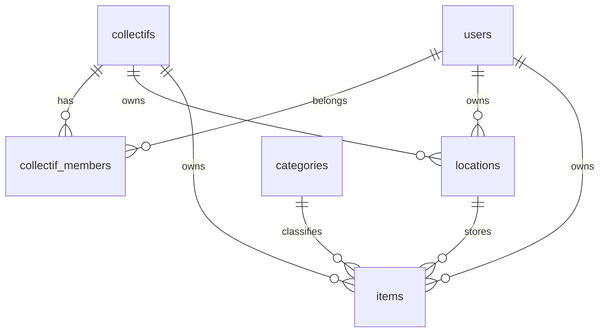

Ownership and storage are separate (ADR 0009): an item has one owner, a collectif **or** a user,
and always sits in one location, itself owned by a collectif **or** a user.

| Table            | Key fields                                                                                                                                                                                                             | Constraints                                                                                                                                                                                                   |
|------------------|------------------------------------------------------------------------------------------------------------------------------------------------------------------------------------------------------------------------|---------------------------------------------------------------------------------------------------------------------------------------------------------------------------------------------------------------|
| `users`          | id, email, name, phone (optional), status, is_platform_admin, role, password_hash (optional, scrypt), rejection_reason, created_at, updated_at, deleted_at                                                             | email unique and lower-case; status ∈ pending, active, rejected, disabled, deleted; role ∈ member, moderator (V0.8), admin (named in the app, V0.10.x; `PLATFORM_ADMIN_EMAILS` adds the listed ones)          |
| `collectifs`     | id, name, slug, city, description, contact_phone (optional), status, requested_by, validated_by, validated_at, rejection_reason                                                                                        | slug unique among pending and active collectifs (a rejected request frees it); status ∈ pending, active, rejected                                                                                             |
| `collectif_members` | user_id, collectif_id, role, status, requested_at, validated_by, validated_at                                                                                                                                          | (user_id, collectif_id) primary key; role ∈ member, responsible; status ∈ pending, active, rejected, removed; an active collectif keeps ≥ 1 active responsible (checked in the removal transaction, rows locked `FOR UPDATE`)|
| `locations`      | id, name, city, address, notes, collectif_id, user_id                                                                                                                                                                  | exactly one of collectif_id / user_id                                                                                                                                                                         |
| `categories`     | id (text key), name (French), parent_id, position                                                                                                                                                                      | seeded by migration 0007 (sound, lighting, video, structure, scenery, power, cabling, other); from V0.7 managed by admins; `name` unique; a category used by an item cannot be deleted (move its items first) |
| `items`          | id, name, description, category_id, brand, model, serial_number, ref, quantity, condition, estimated_value, location_id, owner_collectif_id, owner_user_id, archived_at, archive_reason, created_by, created_at, updated_at | quantity ≥ 1; location_id required, `ON DELETE RESTRICT`; exactly one owner; condition ∈ new, good, worn, repair, broken; archive_reason ∈ sold, lost, broken, other, moderated, set iff archived_at; ref (≤ 60 chars, stored NFC, no C0/DEL/C1 control character) unique per owner with `inv_fold`, archived items included (US-0.10.3) |
| `sessions`       | id, user_id, data (jsonb), expires_at, created_at                                                                                                                                                                      | signed-in sessions only (visitors' stay in the cookie); user_id → users, deleted with the user; expired rows purged hourly (ADR 0017)                                                                         |
| `sign_in_tokens` | token_hash, user_id, purpose, expires_at, used_at, created_at                                                                                                                                                          | only the SHA-256 of the token is stored; single use; purpose ∈ sign_in (15 min), password_reset (30 min)                                                                                                      |
| `rate_limits`    | key_hash, hits, reset_at                                                                                                                                                                                               | key_hash is a SHA-256 of the limited key (no address stored); purged hourly once reset_at passed (ADR 0018)                                                                                                   |
| `item_deletion_requests` | item_id, requested_by, requested_at                                                                                                                                                                                    | one open request per item (item_id primary key); deleted with the item (US-0.8.10)                                                                                                                            |
| `imports`                | id, created_by, location_id, file_name, header, rows, row_count, column_mapping, value_mapping, forced_rows, created_at, expires_at                                                                                    | one per author (a new file replaces it); ≤ 2,000 rows; lives one hour, purged hourly; deleted with its author or location (ADR 0026)                                                                          |
| `import_templates`       | id, collectif_id, user_id, column_map, value_map, updated_by, updated_at                                                                                                                                               | one per owner (collectif xor person); the choices validated last, merged, at most 100 titles and 300 values per kind (ADR 0027)                                                                               |
| `audit_log`      | id, actor_id, action, entity, entity_id, payload (jsonb), at                                                                                                                                                           | append only; IDs only, no personal data (ADR 0010)                                                                                                                                                            |

`audit_log` actions so far: `account.approved|rejected|disabled|enabled`,
`user.moderator_named|moderator_removed`, `collectif.approved|rejected|updated`,
`member.requested|approved|rejected|removed|left`, `responsible.named`,
`responsible.approved|rejected|removed`, `location.created|updated|deleted`,
`item.created|updated|moved|archived|contacted|deleted|deletion_requested|deletion_rejected`. `inventory.exported` (entity `collectif` or `user`, payload: the item count) records each CSV
export. `import.confirmed` (entity `import`, payload: owner, location and counts) records each
import; the items it creates, updates or moves carry `importId` in their own entries. A
deleted item's entries stay in the log (IDs only, ADR 0010); its page and history are gone. Payloads hold IDs, enum values and field names
only; `readHistory()` resolves names at display time. The item page shows an allow-list
(`itemHistoryActions`): `item.contacted` stays in the log for admins and is never displayed.

Added later:

| Version | Change                                                                                                                                         |
|---------|------------------------------------------------------------------------------------------------------------------------------------------------|
| V0.11   | `items.photo_key` (object key in the photo store, chosen with the storage re-architecture)                                                     |
| V1.1    | sharing tables (defaults per collectif, circles, per-item overrides); until then visibility derives from membership (ADR 0021)                 |

References are compared as `inv_fold` does: case and the accents of its list are ignored (`É`,
`é` and `e` collide), other characters stay distinct (`ø` and `o`, `ß` and `ss`, a no-break space
and a space). Values are normalised to NFC before they are stored or compared, so an accent typed
as one character or as a letter plus a combining mark is the same. A lookup by reference must
spell out `ref is not null`, as `refTaken` does: `inv_fold(null)` is `''`, and the partial unique
indexes are only used with that predicate.

"Exactly one" rules are written as `CHECK (num_nonnulls(a, b) = 1)` in the migration, not only in
code.
