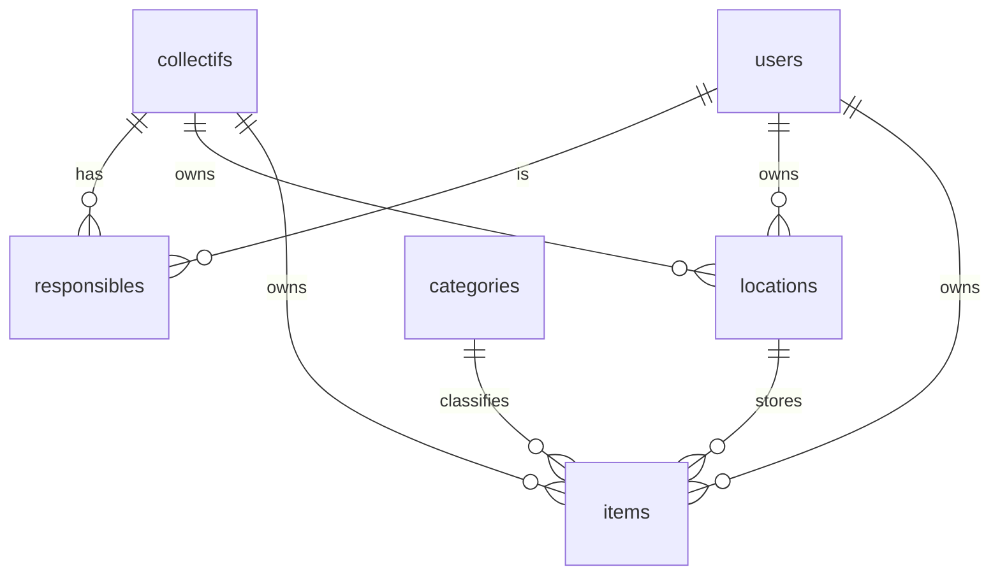

Ownership and storage are separate (ADR 0009): an item has one owner, a collectif **or** a user,
and always sits in one location, itself owned by a collectif **or** a user.

| Table            | Key fields                                                                                                                                                                                             | Constraints                                                                        |
|------------------|--------------------------------------------------------------------------------------------------------------------------------------------------------------------------------------------------------|------------------------------------------------------------------------------------|
| `users`          | id, email, name, phone (optional), status, is_platform_admin, rejection_reason, created_at, updated_at, deleted_at                                                                                     | email unique and lower-case; status ∈ pending, active, rejected, disabled, deleted |
| `collectifs`     | id, name, slug, description, contact_phone (optional), status, requested_by, validated_by, validated_at                                                                                                | slug unique; status ∈ pending, active, rejected                                    |
| `responsibles`   | user_id, collectif_id, status, requested_at, validated_by                                                                                                                                              | (user_id, collectif_id) unique; an active collectif keeps ≥ 1 active responsible   |
| `locations`      | id, name, city, address, notes, collectif_id, user_id                                                                                                                                                  | exactly one of collectif_id / user_id                                              |
| `categories`     | id, name, parent_id                                                                                                                                                                                    | seeded: sound, lighting, video, structure, scenery, power, cabling, other          |
| `items`          | id, name, description, category_id, brand, model, serial_number, quantity, condition, estimated_value, location_id, owner_collectif_id, owner_user_id, archived_at, created_by, created_at, updated_at | quantity ≥ 1; location_id required; exactly one owner                              |
| `sessions`       | id, user_id, data (jsonb), expires_at, created_at                                                                                                                                                      | user_id → users, deleted with the user (ADR 0017)                                  |
| `sign_in_tokens` | token_hash, user_id, expires_at, used_at, created_at                                                                                                                                                   | only the SHA-256 of the token is stored; 15 min, single use                        |
| `audit_log`      | id, actor_id, action, entity, entity_id, payload (jsonb), at                                                                                                                                           | append only; IDs only, no personal data (ADR 0010)                                 |

Added later:

| Version | Change                                                                              |
|---------|-------------------------------------------------------------------------------------|
| V0.7    | `items.photo_key` (MinIO object key)                                                |
| V0.8    | `items.ref`, unique per owner, for re-import without duplicates; `import_templates` |
| V1.1    | visibility tables (defaults per collectif, circles, per-item overrides)             |

"Exactly one" rules are written as `CHECK (num_nonnulls(a, b) = 1)` in the migration, not only in
code.
