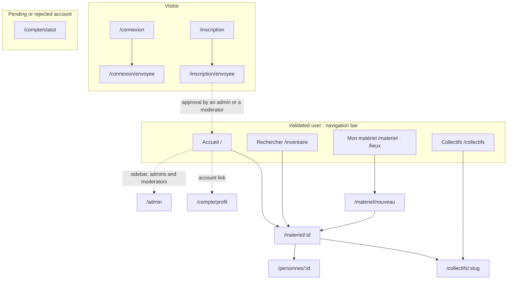
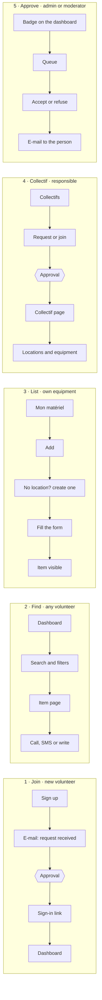

One responsive interface serves phones and computers: the same server-rendered pages, the same
URLs, a layout that adapts to the width ([ADR 0019](../../adr/0019-interface-conventions/), and
[ADR 0022](../../adr/0022-sidebar-navigation-on-computers/) for computers).
Pages and copy are in French; this page uses their French names.

## Principles

1. **Phone first, then the full width.** Volunteers use the app in a storage room or a van; every
   page is designed at 390 px wide first. On a computer it is rearranged to use the whole window,
   not widened as a centred column.
2. **Organised by task**, not by database table: find, list my equipment, manage a collectif.
3. **Search one tap away** from everywhere: it is task number one.
4. **Guide rather than block**: an empty list proposes the next action; a missing location is
   created from the add form.
5. **Owner and location always visible** on an item: ownership ≠ storage
   ([ADR 0009](../../adr/0009-ownership-and-locations/)), and only the city is shown to others.
6. **Plain French**, the words of the field ("Mon matériel", "Rangé à", "Appartient à").
7. **No client JavaScript, accessible**: plain links and forms (ADR 0015), WCAG AA.

## Site map

## Navigation

| Entry        | URL                        | Holds                                                                          |
|--------------|----------------------------|--------------------------------------------------------------------------------|
| Accueil      | `/`                        | search field, pending requests (admins, moderators), my collectifs, recent     |
| Rechercher   | `/inventaire`              | text search, filters (category, collectif, city), results                      |
| Mon matériel | `/materiel`, tab `/lieux`  | what is stored in my locations: mine, my collectifs', borrowed; tab Lieux      |
| Collectifs   | `/collectifs`              | list of collectifs, request a new one; each collectif page has tabs            |
| *Top bar*    | `/compte/profil`, `/admin` | search, Ajouter du matériel, account (initials); Administration in the sidebar |

- **Phone (< 720 px):** a tab bar fixed at the bottom with the four entries, icon and label.
- **Computer (≥ 720 px):** the same `<nav>` becomes a left rail of 84 px (icon and label) up to
  1099 px, then a sidebar of 240 px with "Mes collectifs" shortcuts (5 at most, then "Tous") and
  Administration at the bottom. A top bar holds the search field (submits to `/inventaire`),
  "Ajouter du matériel" and the account link.
- **Content is fluid**: no page-wide `max-width`, only running text (`68ch`) and form fields are
  limited; above 2000 px the content stops at 1760 px. Window breakpoints (720, 1100, 1440) drive
  the shell; components adapt to their container (`@container`, `auto-fill`).
- **Breadcrumb** above the page title on computers (Collectifs › Collecti'FROG › item); « Retour »
  on phones.
- The current entry carries `aria-current="page"`; the bar is a `<nav aria-label>`.
- Detail pages have one link labelled « Retour » that goes back one page. The server builds it from
  the `Referer` header (sent for same-origin navigation, `Referrer-Policy: same-origin`) when it is
  an internal path, and falls back to the section's list page otherwise; no JavaScript, and it can
  never point off the site.
- Tabs inside a page (Mon matériel: Matériel, Lieux; collectif: Matériel, Lieux, Responsables,
  Membres from V0.8) are links to distinct URLs, so they work without JavaScript and can be shared.

## Journeys

Deduced from the user stories V0.2 to V0.8. Coloured steps wait for a person with approval rights.

| Journey     | Stories                       | What must hold                                                         |
|-------------|-------------------------------|------------------------------------------------------------------------|
| 1 Join      | US-0.2.1 → US-0.2.5           | the pending page says how long it takes and whom to contact            |
| 2 Find      | US-0.6.1 → US-0.6.3, US-0.7.6 | three taps at most from the dashboard to the owner's phone             |
| 3 List      | US-0.4.2, US-0.5.1, US-0.7.4  | a location is created without leaving the add form                     |
| 4 Collectif | US-0.3.1 → US-0.3.5, US-0.8.3 | a responsible lands on the collectif page, "Ajouter du matériel" first |
| 5 Approve   | US-0.2.4, US-0.3.7, US-0.8.4  | one table in `/admin`, Accept and Refuse on each row, undo right after |

From V0.8, a request to join a collectif is approved by its responsibles, not by the platform.

## Pages

| Zone         | Pages                                                                                                              |
|--------------|--------------------------------------------------------------------------------------------------------------------|
| Visitor      | `/connexion`, `/connexion/envoyee`, `/connexion/lien/:token`, `/inscription`, `/inscription/envoyee`               |
| Pending      | `/compte/statut`, `/compte/statut/redemander`                                                                      |
| Accueil      | `/`                                                                                                                |
| Rechercher   | `/inventaire`                                                                                                      |
| Item         | `/materiel/:itemId` and its `/modifier`, `/deplacer`, `/archiver`, `/contacter`                                    |
| Mon matériel | `/materiel`, `/materiel/nouveau`, `/lieux`, `/lieux/nouveau`, `/lieux/:locationId` (+ `/modifier`, `/supprimer`)   |
| Collectifs   | `/collectifs`, `/collectifs/nouveau`, `/collectifs/:slug` (+ `/modifier`, `/devenir-responsable`)                  |
| People       | `/personnes/:userId`                                                                                               |
| Account      | `/compte/profil` (sections: profil, affichage, collectifs, données, à propos), `/compte/supprimer`, `/deconnexion` |
| Admin        | `/admin` (= `/admin/demandes`), `/admin/comptes`, `/collectifs`, `/moderateurs`, `/categories`, `/instance`        |

URLs are a contract: V0.7 changes what the pages show and how they are reached, not their URLs.
It adds a few ([ADR 0022](../../adr/0022-sidebar-navigation-on-computers/)):

- `?vue=liste|grille` and `?tri=<column>` on `/inventaire` and on a collectif's equipment; a filter
  is a GET parameter, so an active filter is a link that removes it;
- `/compte/supprimer`, a confirmation page instead of a modal window;
- `/admin/demandes` (also `/admin`), `/admin/comptes`, `/admin/collectifs`, `/admin/moderateurs`,
  `/admin/categories`, `/admin/instance`.

## Page templates

From 720 px every page uses one of four templates; below 720 px each falls back to one column in
the same DOM order.

| Template | Used by                                  | Computer layout                                                                        |
|----------|------------------------------------------|----------------------------------------------------------------------------------------|
| Index    | Rechercher, Mon matériel, collectif page | filters on the left (sticky, with counts), active filters, sort, list or grid          |
| Detail   | item page, collectif page, person page   | content on the left, sticky side panel on the right: owner, location, contact, actions |
| Settings | Mon compte, Administration               | in-page contents or section links, sections "explanation, card", danger zone last      |
| Wizard   | import, add and edit forms               | steps or section cards, two fields per row, sticky summary with the save button        |

- Lists are **dense tables by default on computers** (`?vue=liste`), cards with `?vue=grille`;
  photos (V0.9) may change the default later. Below 720 px they are cards.
- No modal window: a confirmation is a page or a `
` in place.

## Components

Every page is built from a few shared pieces in `app/ui/`, styled by `public/styles.css`:

| Piece       | Rule                                                                                                                          |
|-------------|-------------------------------------------------------------------------------------------------------------------------------|
| Button      | one primary per screen; 44 px high at least; a verb ("Enregistrer")                                                           |
| Field       | visible label, hint under it, error in French under it, `aria-describedby`                                                    |
| Item card   | name, quantity, category, owner · city; the whole card is the link                                                            |
| Tabs        | links to distinct URLs, current one marked                                                                                    |
| Data table  | dense rows, sortable headers as links (`?tri=`), columns hidden by container query as space shrinks; cards below 720 px       |
| Side panel  | sticky on computers, after the content in the DOM, so it comes after it on phones                                             |
| Empty state | says why it is empty and offers the next action                                                                               |
| Notice      | confirmation after every action (flash message), `role="status"`                                                              |
| Info bubble | secondary explanations behind an ⓘ next to a heading; `
`/`
`, so it opens on tap or click without JavaScript |

## Lessons from the Matosthèque audit

The UX audit ([.ia/sources/matostheque-ux-audit.md](https://github.com/CollectiFrog/InventAssos/blob/dev/.ia/sources/matostheque-ux-audit.md))
ran the Matosthèque with test data. What it changes here: owner choice limited to me and my
collectifs and recalled before saving, accent-insensitive search (done), useful empty states,
errors as text, feedback after every action, return to the requested page after sign-in,
one-tap call and SMS, accessible contrast checked in CI, archive instead of delete (done).
QR labels, kits and check-lists are for later versions.
