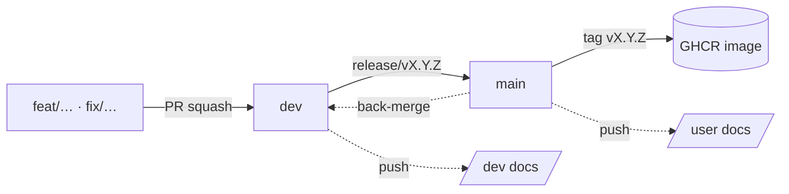

Published from the `dev` branch: it always describes the latest integrated work,
which may be ahead of the released version described in the user docs.

| Section                                              | For                                       |
|------------------------------------------------------|-------------------------------------------|
| [Setup](contribute/setup/)                           | getting a working dev environment         |
| [Workflow](contribute/workflow/)                     | branches, commits, PRs, conventions       |
| [Work in progress](contribute/board/)                | the kanban board (GitHub Projects)        |
| [Releasing](contribute/releasing/)                   | shipping a version and deploying it       |
| [Roadmap](product/roadmap/)                          | versions V0.1 to V1.0 and beyond          |
| [User stories](product/user-stories/)                | what each version delivers (the spec)     |
| [GDPR checklist](product/gdpr-checklist/)            | what must be true before V1.0             |
| [Architecture](architecture/overview/)               | how the system is built (source of truth) |
| [Decisions](adr/0001-record-architecture-decisions/) | why it is built that way (ADR)            |

